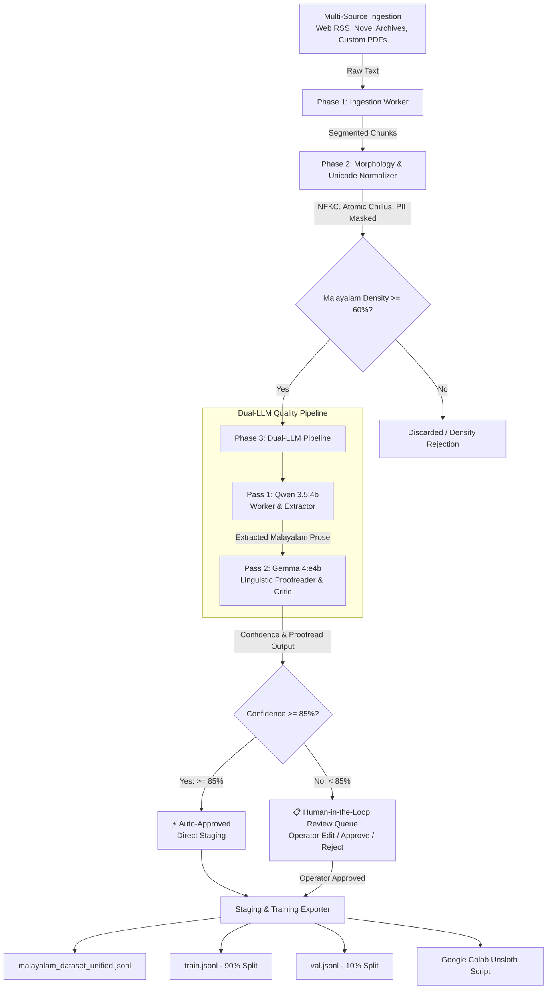

# 🌴 malayaLLM v2.3.0
### Autonomous Modular Malayalam Data Pipeline & Operations Center
**Dual-LLM Quality Pipeline (Qwen 3.5 + Gemma 4) • Multi-Source & PDF Ingestion • Automated HITL Gating • QLoRA / Unsloth Fine-Tuning**

[](LICENSE)
[](https://python.org)
[](#local-ollama--air-gapped-mode)
[](#training--fine-tuning-pipeline)
[](#morphology--unicode-normalization)

---

## 📖 Overview

**`malayaLLM`** is an enterprise-grade, high-performance data curation and pipeline engine tailored specifically for the Malayalam language (മലയാളം). Built without heavy orchestrator overhead, it couples a pure Python modular backend with a glassmorphic real-time web Operations Center.

The system automates the complete data lifecycle:
1. **Multi-Source Ingestion**: Ingests Malayalam text from Web scrapers, live RSS news dispatches, and custom PDF documents (with automated OCR cleaning, header/footer/watermark stripping, and semantic chunking).
2. **Morphology & Unicode Cleaning**: Enforces strict UTF-8 NFKC normalization, repairs non-standard legacy Chillu sequences (`ൺ, ൻ, ർ, ൽ, ൾ, ൿ`), redacts PII (Aadhaar, PAN, emails, phone numbers), and gates items through a strict $\ge 60\%$ Malayalam script density filter.
3. **Dual-Pass Quality Pipeline**:
   - **Pass 1 (Extractor / Worker)**: **Qwen 3.5 (4B)** repairs broken text, removes web artifacts, and extracts coherent prose.
   - **Pass 2 (Linguistic Reviewer / Proofreader)**: **Gemma 4 (e4b)** audits Dravidian syntax, checks agglutinative morphology, and evaluates confidence ($0.0$ to $1.0$).
4. **Automated Quality Routing**:
   - **Auto-Approve ($\ge 85\%$ Confidence)**: Directly staged for instruction tuning without human intervention.
   - **Human-in-the-Loop ($< 85\%$ Confidence)**: Routed to the interactive Review Queue for operator audit, side-by-side editing, and sign-off.
5. **Turnkey QLoRA & Unsloth Export**: Outputs a unified dataset (`malayalam_dataset_unified.jsonl`), an explicit 90/10 train/validation split (`train.jsonl` and `val.jsonl`), and a complete Google Colab training script with 50-step Google Drive checkpoint relays.

---

## 🏛️ System Architecture



---

## ✨ Core Highlights

### 1. Dual-LLM Quality Architecture (Qwen + Gemma)
`malayaLLM` utilizes a dual-model division of labor:
- **Worker / Extractor (`qwen3.5:4b`)**: Handles noisy OCR output, strips HTML/CSS boilerplate, rectifies punctuation, and standardizes Malayalam prose.
- **Reviewer / Proofreader (`gemma4:e4b`)**: Inspects Malayalam verb endings, agglutinative inflections, checks for awkward English translationese, and generates an objective confidence score ($0.00$ to $1.00$).

### 2. Direct PDF Upload & Cleaning Engine
The operator can upload PDF books, classic novels, or research documents directly through the Web Operations Center:
- **Noise Stripping**: Automatically removes running headers, footers, publisher watermarks, and page numbers (e.g. `പേജ് \d+`, `Page \d+ of \d+`).
- **Hyphen & Line-Break Healing**: Reconstructs broken intra-word syllables caused by column layouts or PDF hyphenation.
- **Semantic Chunking**: Employs sentence-boundary paragraph segmentation (150–350 words) to avoid splitting Malayalam compound clauses.

### 3. Curated Classic & Modern Literature Archives
Included out-of-the-box in `data/sources/novels/`:
- **Indulekha** (ഒ. ചന്തുമേനോൻ, 1889) — Earliest major novel in Malayalam literature.
- **Chemmeen** (തകഴി ശിവശങ്കരപ്പിള്ള) — Classic realist coastal narrative.
- **Neelavelicham** (വൈക്കം മുഹമ്മദ് ബഷീർ) — Iconic romantic & surrealist prose.
- **Randamoozham** (എം.ടി. വാസുദേവൻ നായർ) — Mahabharata retold through Bhima's perspective.

### 4. 100% Offline Capable & Cloud Key Pool Rotation
- **Zero Internet Requirement**: Runs with local Ollama daemon or the deterministic heuristic Dravidian critic.
- **Multi-Key Fallback**: Configure round-robin key pools for **Groq**, **Google Gemini**, **OpenRouter**, and **NVIDIA NIM**. If a cloud key hits HTTP 429 rate limits, it hot-swaps to the next key without crashing.

---

## 🚀 Quick Start Guide

### Prerequisites
- Python 3.10+
- [Ollama](https://ollama.com/) (Optional for local offline inference):
  ```bash
  ollama pull qwen3.5:4b
  ollama pull gemma4:e4b
  ```

### Installation

1. **Clone the repository**:
   ```bash
   git clone https://github.com/ShorrohS/malayaLLM.git
   cd malayaLLM
   ```

2. **Install dependencies**:
   ```bash
   pip install -r requirements.txt
   ```

3. **Start the Operations Center**:
   ```bash
   python server.py
   ```

4. **Access the Dashboard**:
   Open **`http://localhost:8080`** in any modern web browser.

---

## 🖥️ Operations Center Interface

The web interface features 4 synchronized panes:
1. **Pipeline Monitor**:
   - Master Play/Pause/Step controls.
   - Dual-LLM status pills with live model parameters.
   - PDF drag-and-drop ingestion zone.
   - Animated node highlights and real-time inspector comparing raw harvested vs. normalized text.
2. **Review Queue**:
   - **🤖 Gemma Auto-Proofread**: Evaluates all pending items in batch, auto-approving items $\ge 85\%$.
   - Interactive Malayalam editor with side-by-side comparison.
   - Filters: *Pending Approval*, *Auto-Approved (≥85%)*, *All Approved*, *Rejected*, *All Items*.
3. **Key Rotator & Credentials**:
   - Manage multiple API keys per provider.
   - Air-gapped local Ollama endpoint configuration.
4. **Training & Export**:
   - One-click dataset export and direct download buttons for unified and split datasets.
   - Turnkey Google Colab QLoRA script with Google Drive checkpoint sync.

---

## 🎯 Fine-Tuning with Unsloth & QLoRA

The exported dataset is pre-formatted for direct ingestion into [Unsloth](https://github.com/unslothai/unsloth) or Hugging Face `TRL` / `SFTTrainer`.

### Dataset Schema (`ChatML` + `Alpaca` Dual-Compatible)
```json
{
  "id": "harvest_chemmeen_01",
  "instruction": "മലയാളത്തിൽ വിശദീകരിക്കുക: ചെമ്മീൻ - കടപ്പുറവും കടലമ്മയുടെ കാരുണ്യവും",
  "input": "",
  "output": "കടപ്പുറത്തെ തിരമാലകൾ എണ്ണമില്ലാത്ത കഥകൾ പറഞ്ഞുതീർക്കുകയാണ്...",
  "messages": [
    {"role": "system", "content": "നിങ്ങൾ ആധികാരികവും ശുദ്ധവുമായ മലയാളത്തിൽ പ്രതികരിക്കുന്ന കൃത്യതയുള്ള ഒരു എഐ സഹായിയാണ്."},
    {"role": "user", "content": "മലയാളത്തിൽ വിശദീകരിക്കുക: ചെമ്മീൻ - കടപ്പുറവും കടലമ്മയുടെ കാരുണ്യവും"},
    {"role": "assistant", "content": "കടപ്പുറത്തെ തിരമാലകൾ എണ്ണമില്ലാത്ത കഥകൾ പറഞ്ഞുതീർക്കുകയാണ്..."}
  ],
  "metadata": {
    "source": "https://sahithya-academy.kerala.gov.in/chemmeen",
    "malayalam_density": 0.942,
    "fluency_score": 0.98,
    "confidence_score": 0.965,
    "auto_approved": true,
    "chillu_fixes": 2,
    "pii_redacted": 0
  }
}
```

### Generated Export Files (`data/approved_training/`)
| File | Format | Purpose |
| :--- | :--- | :--- |
| `malayalam_dataset_unified.jsonl` | JSONL | Single unified corpus of all curated records |
| `train.jsonl` | JSONL | 90% deterministic training split |
| `val.jsonl` | JSONL | 10% deterministic validation split |
| `dataset_manifest.json` | JSON | Dataset audit report, token counts, and metrics |
| `colab_qlora_unsloth.py` | Python | Standalone Colab training script with Drive relay |

---

## 📂 Project Structure

```
malayaLLM/
├── backend/
│   ├── db.py                 # SQLite ledger, WAL mode, Review Queue, migrations
│   ├── key_rotator.py        # Multi-provider key pool & cooldown manager
│   └── pipeline_engine.py    # Non-blocking orchestrator (Phases 1-4)
├── workers/
│   ├── ingestor.py           # Multi-source harvester (Web, RSS, Files, Novels)
│   ├── normalizer.py         # NFKC, atomic Chillu repair, PII redaction, density gating
│   ├── judge.py              # LLM quality judge and Dravidian heuristic critic
│   ├── dual_llm.py           # Dual-pass pipeline (Qwen 3.5 Worker + Gemma 4 Reviewer)
│   ├── pdf_extractor.py      # PDF text extractor, noise cleaner & semantic chunker
│   └── exporter.py           # Unified & split JSONL exporter, Colab script generator
├── data/
│   ├── pipeline_state.db     # SQLite runtime database
│   ├── keys_vault.json       # Key configuration vault
│   ├── sources/
│   │   ├── novels/           # Classical & modern Malayalam novel corpora
│   │   └── uploads/          # User-uploaded PDFs
│   └── approved_training/    # Staged datasets (unified, train, val, manifest)
├── css/
│   └── operations.css        # Modern glassmorphic operations center stylesheet
├── js/
│   └── dashboard.js          # Pure ES6 reactive client dashboard
├── index.html                # Operations Center UI
├── server.py                 # FastAPI REST server & static web server
├── requirements.txt          # Python dependencies
└── README.md                 # Complete documentation
```

---

## 📜 REST API Reference

| Method | Endpoint | Description |
| :--- | :--- | :--- |
| `GET` | `/api/health` | Service health and pipeline state |
| `GET` | `/api/pipeline/status` | Live counters, throughput, active item |
| `POST` | `/api/pipeline/start` | Resume continuous autonomous pipeline loop |
| `POST` | `/api/pipeline/pause` | Gracefully pause pipeline loop |
| `POST` | `/api/pipeline/step` | Execute a single end-to-end iteration |
| `GET` | `/api/pipeline/models` | Status of Qwen 3.5 and Gemma 4 models |
| `POST` | `/api/ingest/upload_pdf` | Upload and clean custom Malayalam PDF |
| `GET` | `/api/queue/review` | Fetch review queue items by status |
| `POST` | `/api/queue/auto_proofread` | Batch proofread pending queue with Gemma |
| `POST` | `/api/queue/action` | Approve or reject items with notes/edits |
| `POST` | `/api/export/trigger` | Generate unified and split datasets |
| `GET` | `/api/export/download/unified` | Download `malayalam_dataset_unified.jsonl` |
| `GET` | `/api/export/download/train` | Download `train.jsonl` (90% split) |
| `GET` | `/api/export/download/val` | Download `val.jsonl` (10% split) |
| `GET` | `/api/export/download/manifest` | Download `dataset_manifest.json` |

---

## 🛡️ License

This project is licensed under the [MIT License](LICENSE).
Made with ❤️ for the Malayalam open-source AI community.
