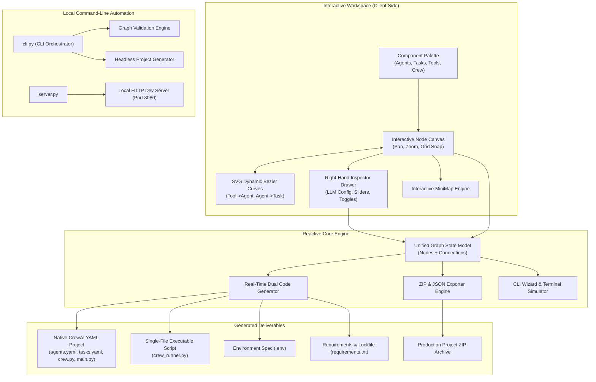

# System Architecture (Active State)

> **Auto-Generated & Synchronized Document**  
> **Source of Truth Policy**: This document reflects **only** the active, currently implemented codebase. Deprecated modules, obsolete flows, and abandoned paths are automatically pruned to prevent documentation drift.

---

> **Last Zero-Drift Audit**: `2026-10-22 15:33:51 UTC` • **Active Components Verified**: `16 modules`

## 1. High-Level Architecture Overview

The **Visual CrewAI Agent & Workflow Builder** is an autonomous, lightweight developer workstation and no-code CLI orchestrator. It couples an interactive visual canvas with a real-time dual code generation engine, CLI execution pipeline, and complete project packaging suite.

---

## 2. Core Subsystems & Responsibilities

| Subsystem | Source Path | Key Responsibilities | Zero-Drift Status |
| :--- | :--- | :--- | :--- |
| **Canvas Engine** | `js/canvas.js` | Pan & zoom transform matrix, 20px grid snapping, drag-and-drop node handling, bezier curve routing, interactive minimap. | **Active** |
| **Node Schema & Catalog** | `js/nodes.js` | Data structures for Agent, Task, Tool, and CrewConfig nodes; LLM model catalog; Tool capability definitions. | **Active** |
| **Property Inspector** | `js/inspector.js` | Sliding parameter drawer; reactive input binding, model dropdowns, temperature & iteration sliders, toggle switches. | **Active** |
| **Code Generation Engine** | `js/generator.js` | Real-time compiler transforming graph state into native CrewAI YAMLs, decorators, standalone script, `.env`, and `requirements.txt`. | **Active** |
| **Export & Packaging** | `js/exporter.js` | Client-side ZIP compilation via JSZip, JSON state import/export, direct file download streams. | **Active** |
| **Workflow Presets Library** | `js/templates.js` | Pre-built production workflow graph definitions (Market Research, Code Security Audit, Offline Ollama). | **Active** |
| **Key Vault & Model Discovery** | `js/key-vault.js` | Live API key credential vault, format validation, and local Ollama model auto-discovery. | **Active** |
| **Diagnostics & Health Engine** | `js/diagnostics.js` | Real-time network and topology auditing, error boundary detection, and click-to-fix handlers. | **Active** |
| **CLI & Simulator** | `js/cli-wizard.js` | Cross-platform terminal command assistant; dry-run graph verification and simulated execution runner. | **Active** |
| **Application Coordinator** | `js/app.js` | Central coordinator; UI event routing, LocalStorage persistence, toast notification manager. | **Active** |
| **CLI Pipeline** | `cli.py` | Terminal tool to list templates, validate workflow JSON files, and generate projects headlessly. | **Active** |
| **Local Runtime Server** | `server.py` | Lightweight zero-dependency HTTP server with Ollama proxy endpoint and UTF-8 stream handling. | **Active** |

---

## 3. Technology Stack

- **Frontend Core**: Vanilla ES6+ JavaScript Modules (`type="module"`), HTML5 Semantic Shell.
- **Styling Architecture**: Vanilla CSS3 Custom Properties (Design System tokens, glassmorphism, dynamic gradients, zero CSS framework dependencies).
- **Libraries (Offline Bundled)**:
  - `assets/prism.min.js`: Syntax highlighting for Python, YAML, Bash.
  - `assets/jszip.min.js`: In-browser asynchronous ZIP project archive generation.
- **Backend / CLI Runtime**: Python 3.10+ (Standard library `http.server`, `argparse`, `pathlib`, `json`).
- **Target Framework**: CrewAI >= 0.86.0 (`crewai`, `crewai-tools`, `python-dotenv`).

---

## 4. Zero-Drift Pruning Policy

1. **Deprecated Module Removal**: Any file or class removed from `js/` or `cli.py` is immediately removed from this document during the automated sync pass.
2. **Dynamic Generation**: Documentation updates are generated directly from the codebase AST, schema registries, and tests via `scripts/doc_pipeline.py`.
3. **No Phantom Endpoints**: Features not backed by working code in the repository must not appear in this active architecture specification.
