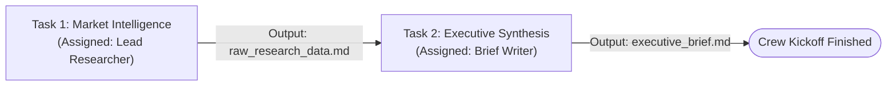
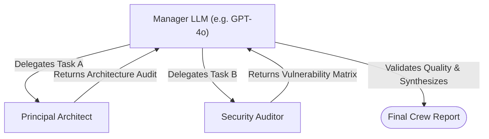
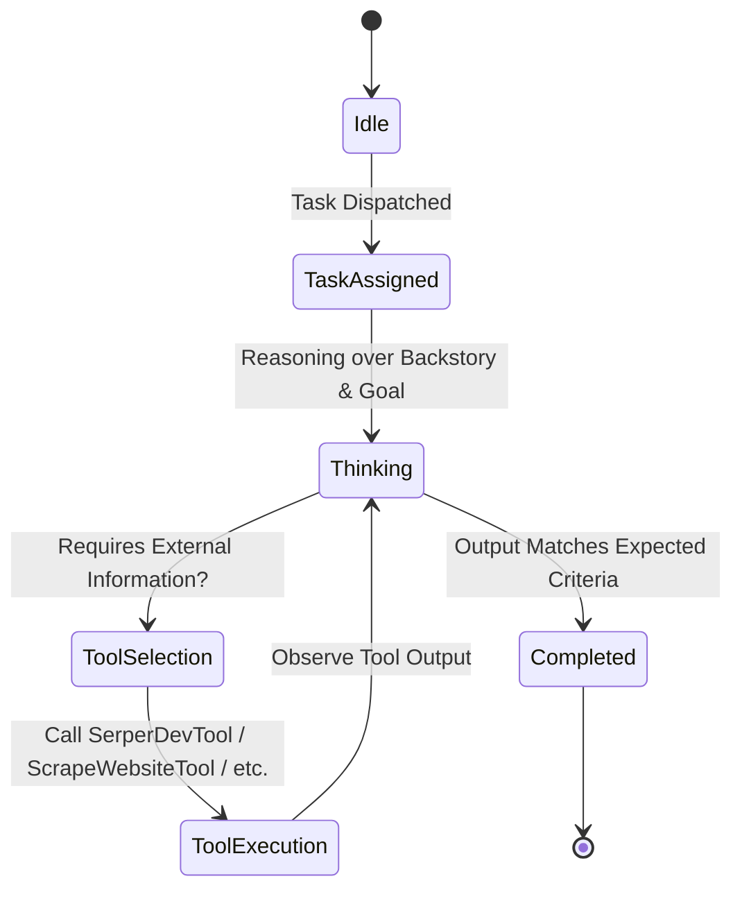

# CrewAI Agent & Workflow Runtime Lifecycle

> **Auto-Generated & Synchronized Document**  
> **Source of Truth Policy**: Describes the execution lifecycles generated by the builder for CrewAI runtimes.

---

## 1. Sequential vs. Hierarchical Execution Lifecycles

The builder supports two primary execution patterns configured via the Crew Config node:

### 1.1 Sequential Process (`Process.sequential`)
Tasks execute one after another in a linear pipeline. The output of prior tasks can automatically serve as context for subsequent tasks.

### 1.2 Hierarchical Process (`Process.hierarchical`)
A Manager LLM (e.g. `gpt-4o`) evaluates incoming tasks, delegates them dynamically across agents, validates the quality of intermediate outputs, and synthesizes the final result.

---

## 2. Agent Tool Invocation Loop

Each agent operates within a structured tool-use loop:

