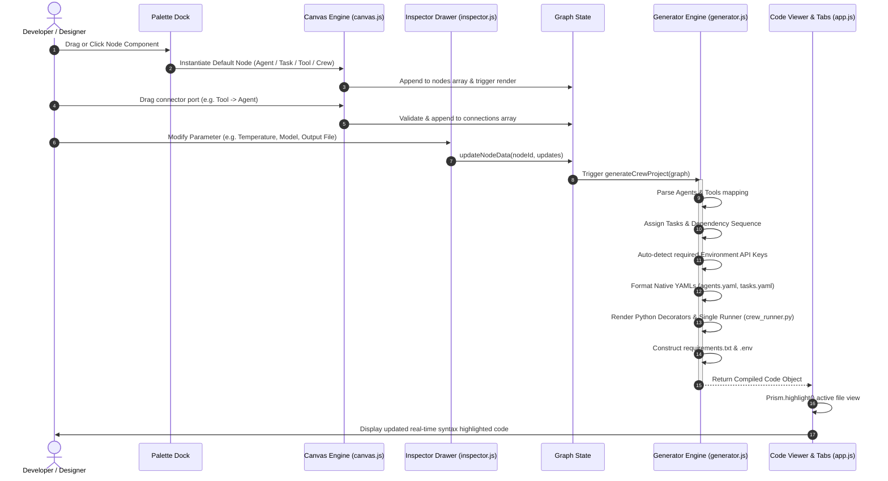
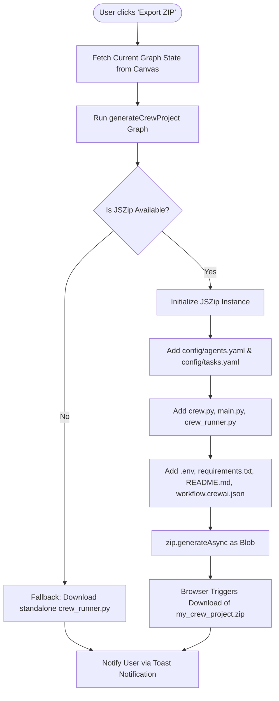
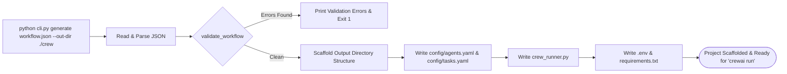

# Workflow Orchestration Technical Process Flows

> **Auto-Generated & Synchronized Document**  
> **Source of Truth Policy**: Describes the active runtime and build flows implemented in `js/canvas.js`, `js/generator.js`, and `cli.py`.

---

## 1. Visual Canvas to Code Compilation Flow

This sequence depicts how a user action on the visual canvas instantly translates into compiled CrewAI deliverables across all tabs.

---

## 2. Project Export & Packaging Flow

---

## 3. Headless CLI Pipeline Execution Flow

